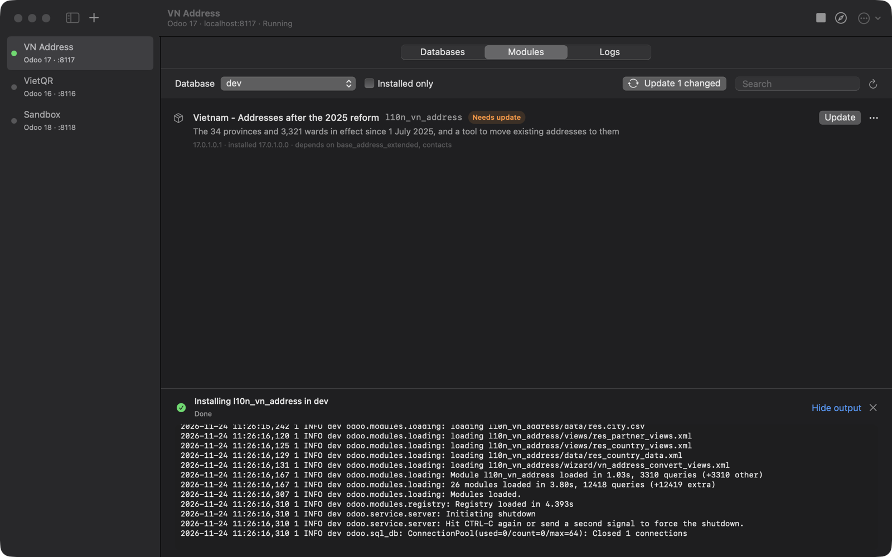

# Berth

Berth is a macOS app for Odoo development environments. Each environment is one Odoo
version (16, 17 or 18) running in Docker with its own PostgreSQL, data and port, and your
addons folders mounted into it. Several can run side by side: a client on Odoo 16, another
on 17, a sandbox on 18.



The Docker, database and log work lives in a Rust library (`core/`); the SwiftUI app
(`Sources/Berth`) calls it through a small C interface that exchanges JSON.

The interface is in English and Vietnamese. It follows the system language, and can be
switched in the settings (⌘,) without restarting.

## Features

- **Environments.** Pick the Odoo version, a port and your addons folders. Berth pulls
  the official `odoo` and `postgres` images, starts both containers, and waits until Odoo
  answers. A folder can contain modules or be a module itself. Edits show up at once:
  developer mode (`--dev=reload,xml,qweb`) restarts Odoo when a Python file changes.
- **Databases.** Create one with base installed, with or without demo data, in English or
  Vietnamese. Duplicate one (its files too), drop one, open it in the browser, or open an
  `odoo shell` on it in Terminal.
- **Modules.** Lists the modules of your addons folders with their state in the chosen
  database: not installed, installed, or **needs update** when the version in
  `__manifest__.py` moved on since it was installed. Install, update one or all changed
  modules, or run the tests of a module.
- **Tests on a clean database.** Running the tests of a module installs it in a fresh
  `test_<module>` database, so a test run never touches a working one. The result reads
  like "0 failed, 0 errors of 18 tests".
- **Logs.** Follows the Odoo log, keeps each traceback with its record, and shows the
  exception on the summary line. Filter by level, hide HTTP requests, search, copy.
- **Upgrade check.** With [odoo-upgrade-check](https://github.com/thanhphu2643/odoo-upgrade-check)
  installed, checks a module for the next Odoo version and lists what to change, line by
  line.

Installs, updates and test runs each run in their own container next to the server. They
can be stopped at once, and they never compete with the server for its port. The running
server picks up installed and updated modules by itself.

## Requirements

- macOS 14 or later.
- Docker Desktop or OrbStack. Berth finds the `docker` command in the usual places even
  when opened from Finder.
- Optional: `pipx install git+https://github.com/thanhphu2643/odoo-upgrade-check`.

## Build from source

Needs Xcode (or the Swift toolchain) and Rust.

```sh
./build.sh   # tests the core, builds build/Berth.app
./dmg.sh     # build/Berth-<version>.dmg
```

## Testing

```sh
cargo test --manifest-path core/Cargo.toml
# Against Docker: creates an environment named "smoke", uses it, and removes it with its data.
cargo run --manifest-path core/Cargo.toml --example smoke -- /path/to/addons 17 8097
```

The smoke run starts an Odoo 17 environment, creates a database in Vietnamese, installs
and updates a module, runs its tests in `test_<module>`, duplicates and drops a database,
reads the log, then stops and removes everything.

## How it works

```
core/src/
  env.rs      an environment: containers, network, volumes, mounts; start, stop, status
  tasks.rs    install, update, test, create a database: one container per task
  db.rs       databases through psql in the PostgreSQL container, with their filestore
  logs.rs     follows docker logs and groups tracebacks with their record
  modules.rs  reads the modules of the addons folders
  pylit.rs    reads Python literals (__manifest__.py) without Python
  jobs.rs     background jobs the app polls and can stop
  docker.rs   finds and runs the docker command
  lib.rs      the C functions the app calls, each taking and returning JSON
Sources/Berth/
  Core.swift  the JSON types and the calls into Rust
  Store.swift app state, polling and settings
  *View.swift the SwiftUI interface
```

Everything Berth creates is named `berth-<id>-…` and labelled `berth.env=<id>`:

| | |
| --- | --- |
| `berth-<id>-odoo` | Odoo, published on `127.0.0.1:<port>` only |
| `berth-<id>-db` | PostgreSQL 15 for Odoo 16, 16 for Odoo 17 and 18 |
| `berth-<id>-data` | volume with the filestore and sessions |
| `berth-<id>-pg` | volume with the databases |
| `berth-<id>` | network between the two |

The Odoo container is recreated when the version, port, addons or developer mode change.
The volumes stay, so the databases survive. Removing an environment asks whether to keep
its databases. Your addons folders are never written to by Berth.

## Limitations

- Odoo runs from the official Docker images (Community). Running Odoo from a source
  checkout is not supported.
- Changing the Odoo version of an environment does not migrate its databases: Odoo cannot
  open a database made by an older version.
- Enterprise addons added as a folder should work like any other addons, but this is not
  tested.

## License

MIT
